# Capturas de tela do aplicativo e do painel

Geradas pelo workflow capturas.yml a partir de `main` (`053c55a`) em 23/10/2026.
Aplicativo com as respostas reais da API para Paragominas; telas desenhadas pelo Robolectric num celular de 411 x 891 dp.
Painel fotografado no Chromium, 1440 px de largura, com a base do produto.

## cartoes_historico_claro

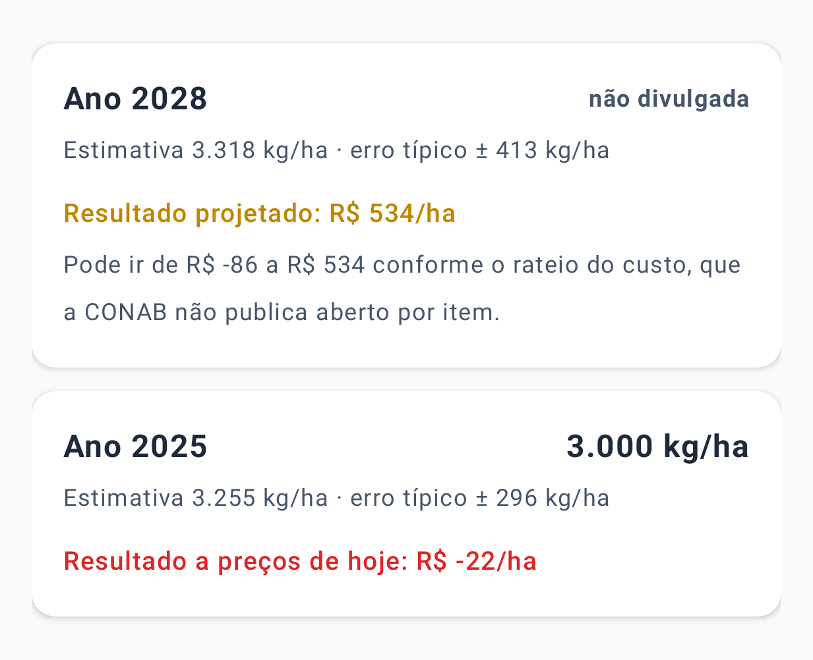

## historico_claro

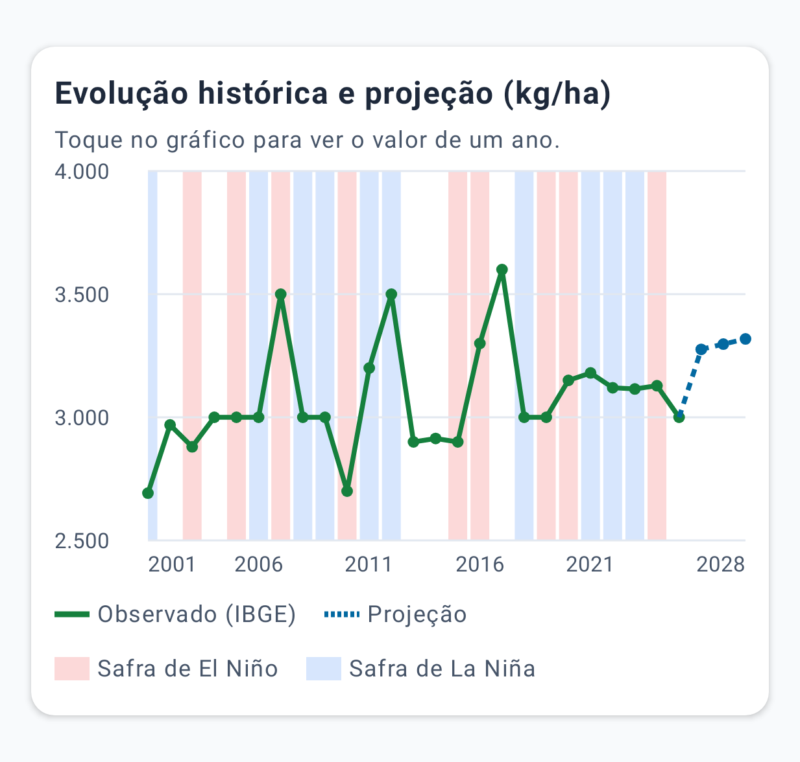

## historico_escuro

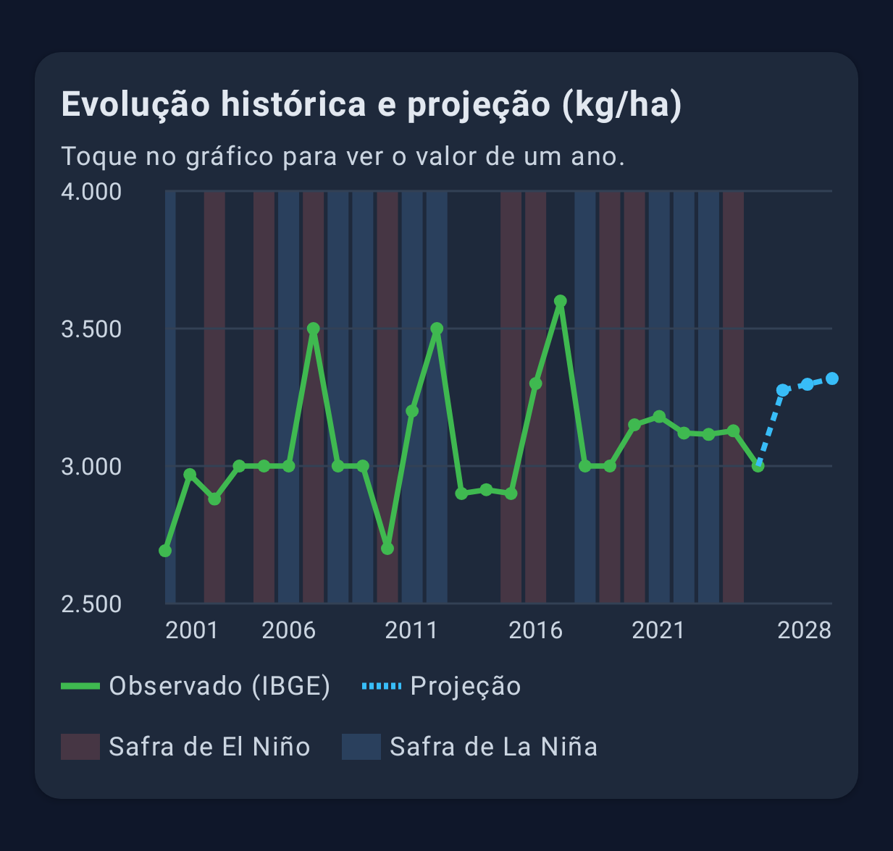

## icone_claro

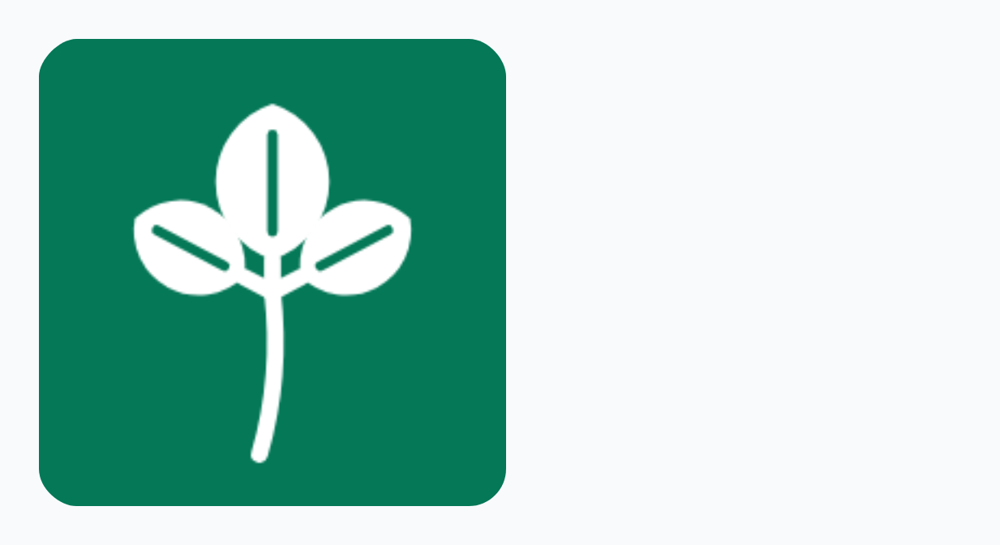

## mercado_claro

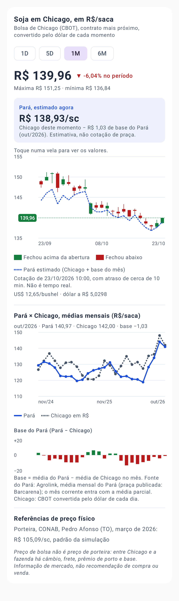

## mercado_escuro

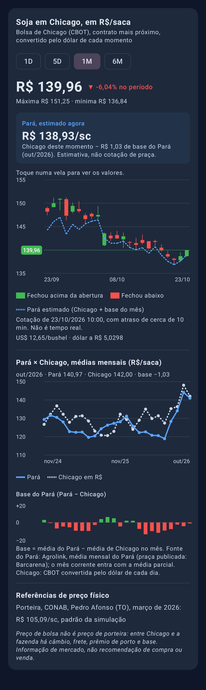

## painel_historico

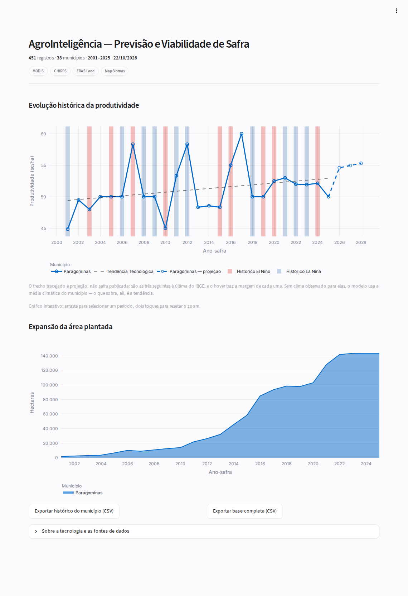

## painel_territorial

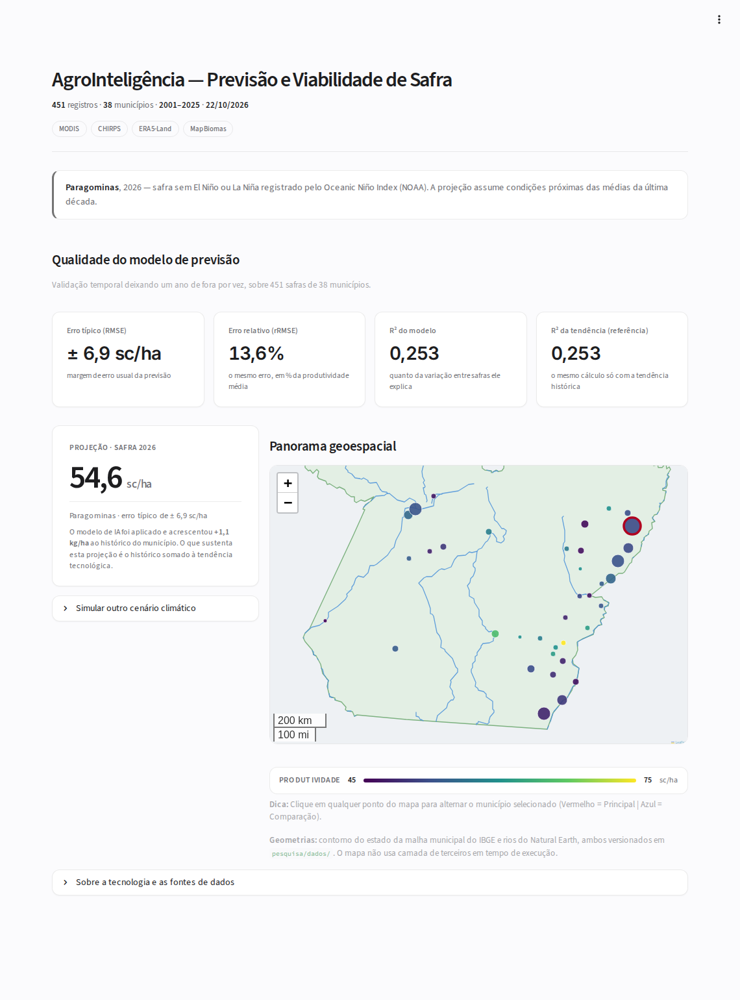

## painel_viabilidade

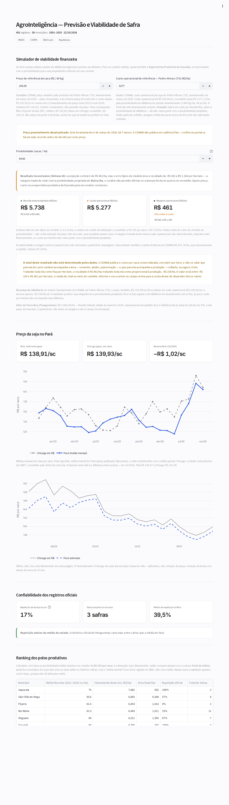

## resumo_claro

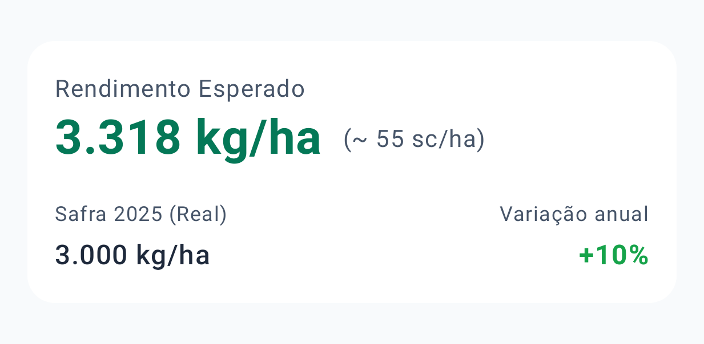

## resumo_escuro

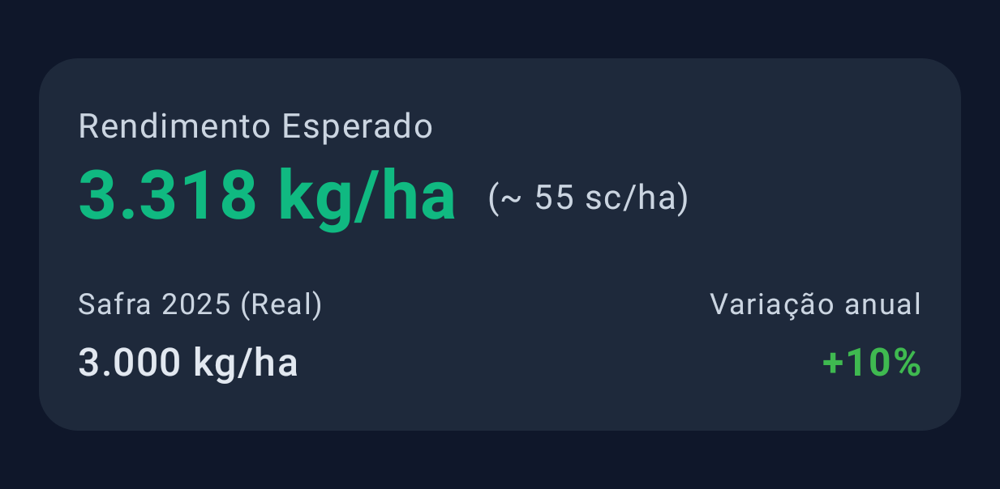

## sobre_claro

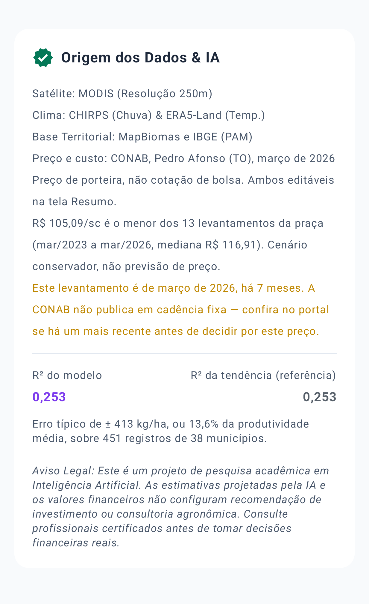

## sobre_escuro

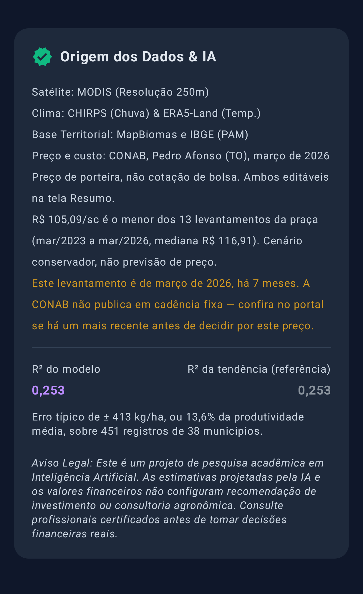

## viabilidade_claro

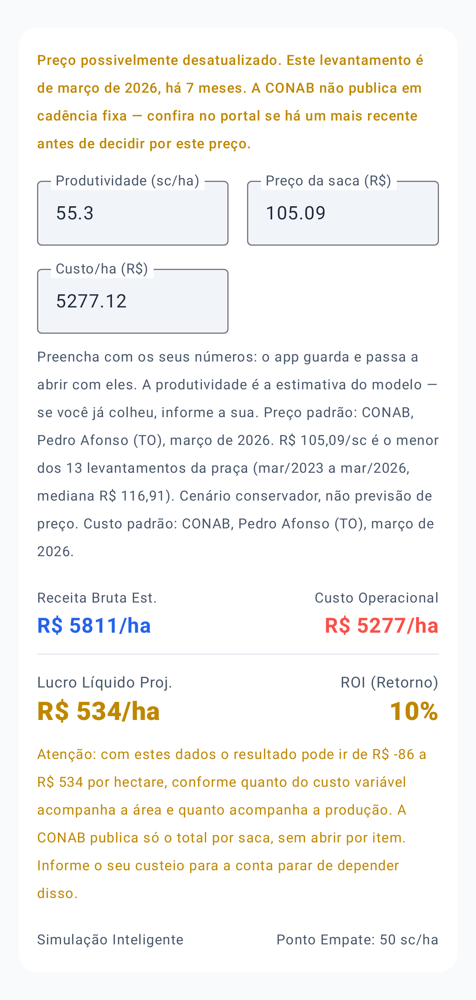

